# Relationships and flows

These are scoped ERD views of the full logical dictionary. All school-to-school links below use composite school_id + id references; diagrams abbreviate columns for readability. Platform entities refer to school beneficiaries explicitly. No public child-data flow exists.

## Identity and guardians

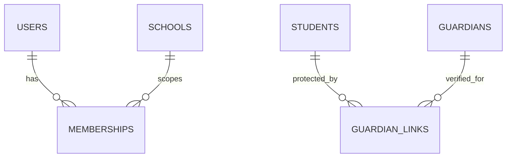

## Session enrollment

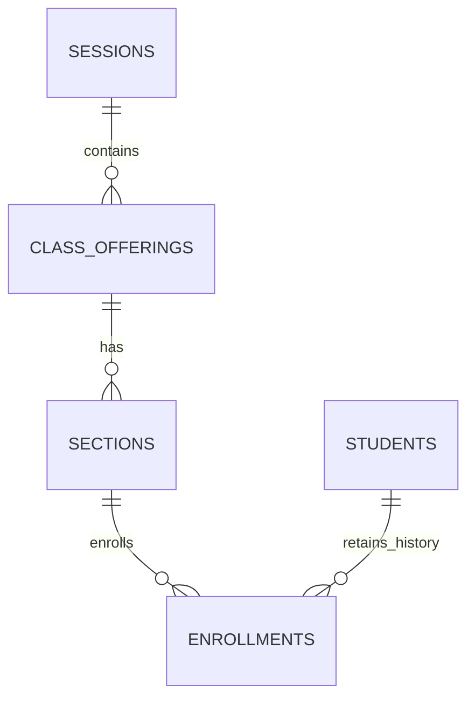

## Attendance audit

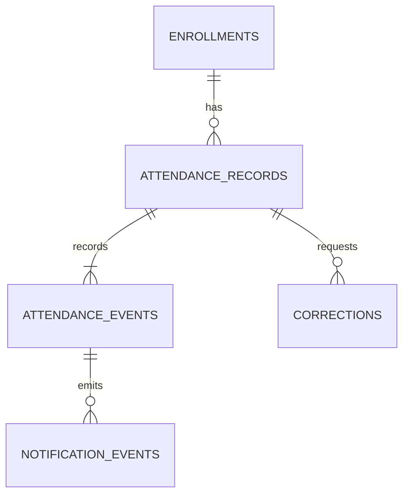

## Academic publication

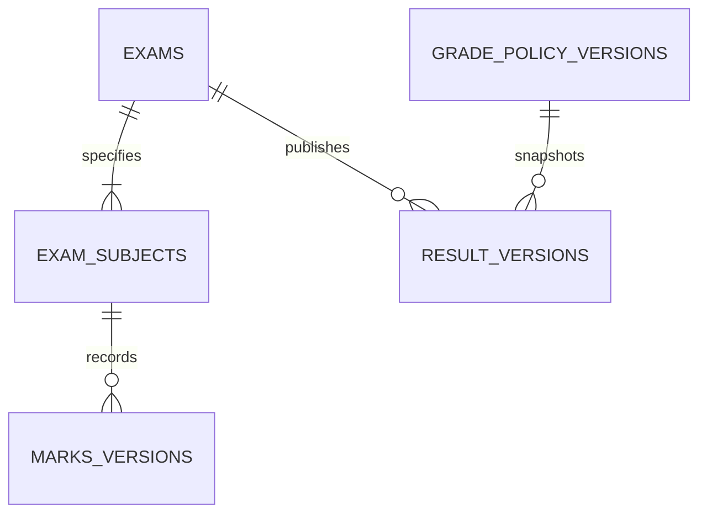

## School fees

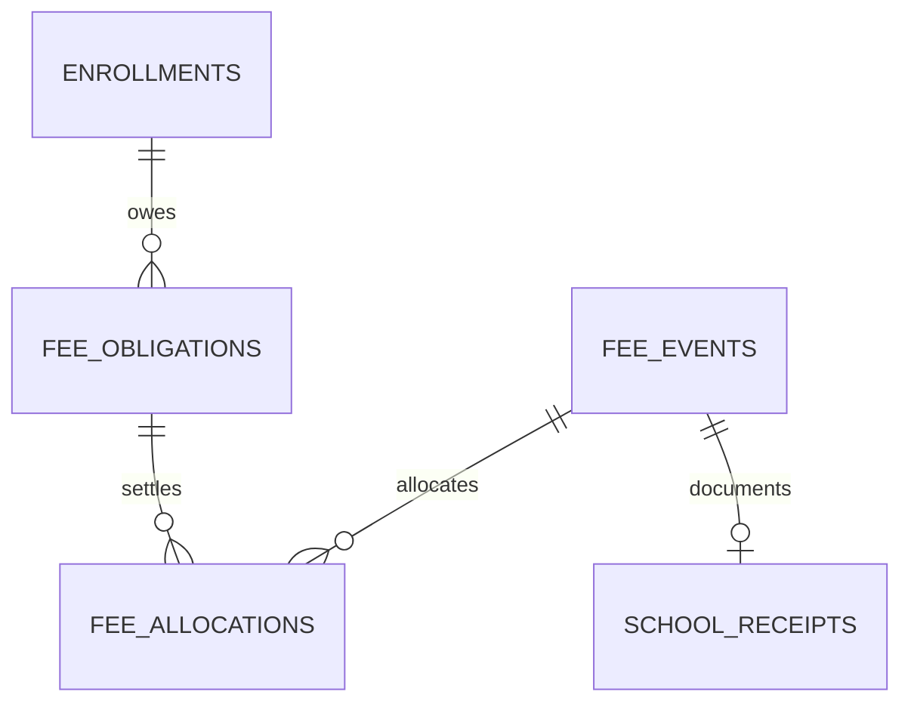

## Platform billing (separate ledger)

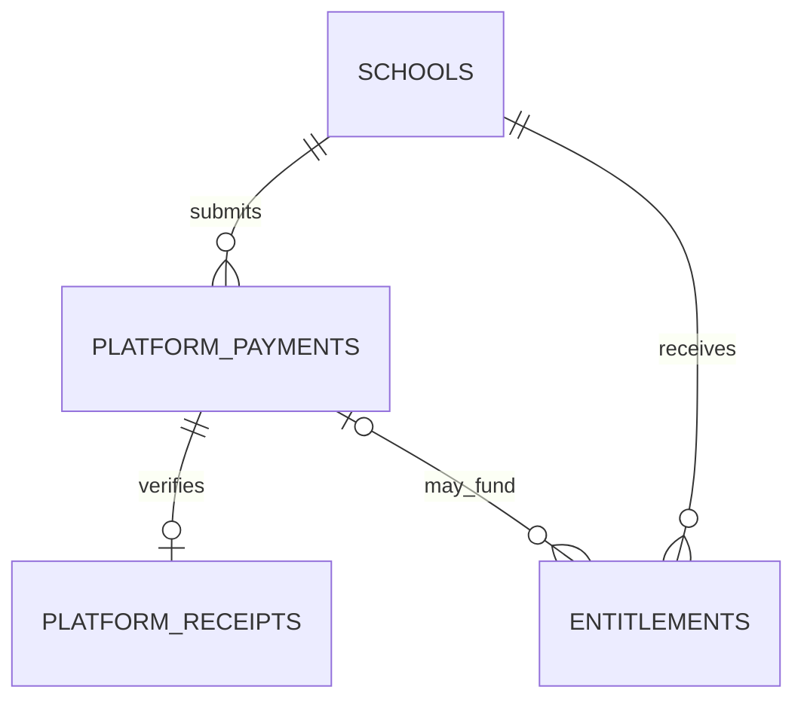

## Private storage

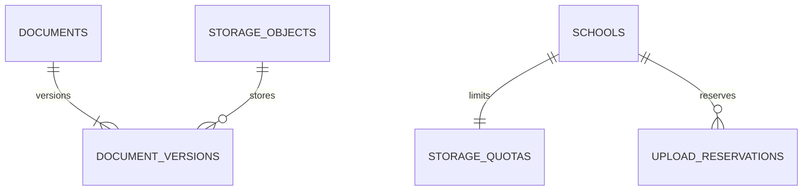

## Module dependency view

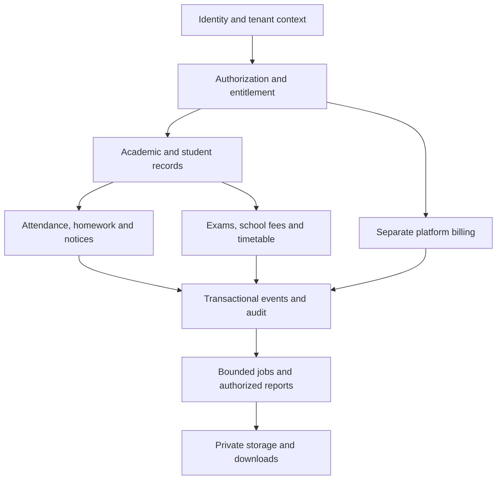

## Data trust boundary

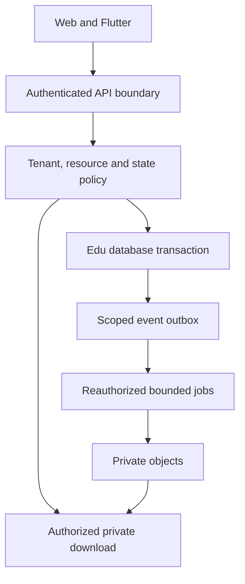

## Expired entitlement behavior

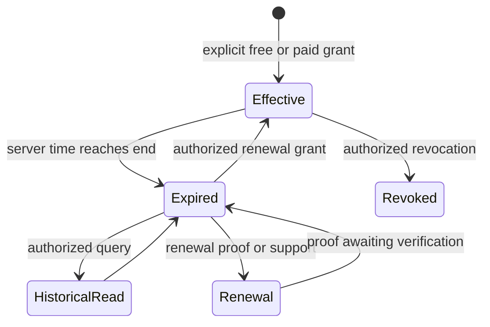

Source prompt lifecycle rules remain authoritative. Scope diagrams do not imply unrestricted relationships, cascading deletes, compulsory payment or proof-driven activation.

## Shared samples and upload limits (ADR-018)

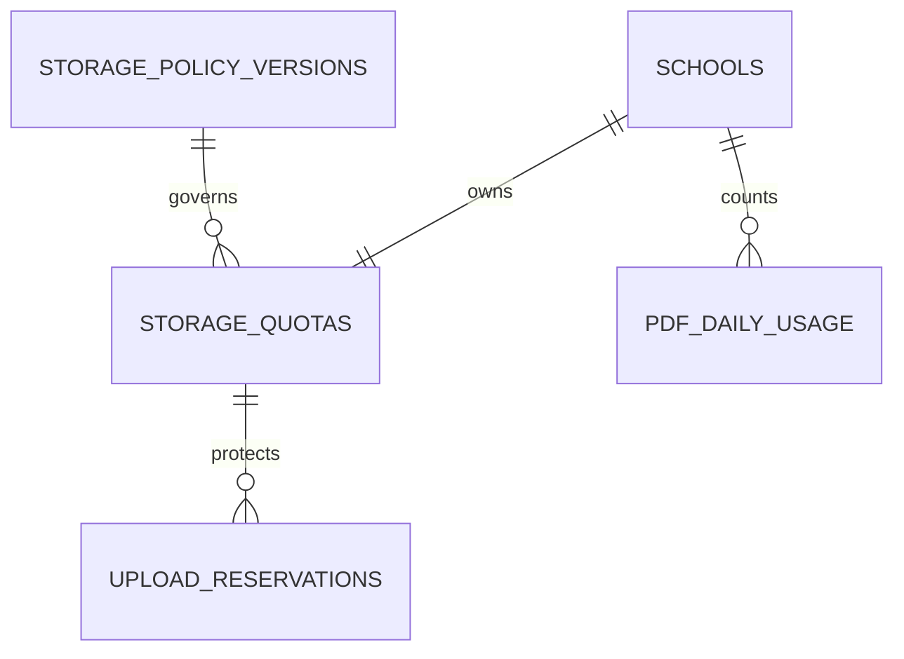

SAMPLE_ASSETS is a platform manifest with no school ownership foreign key. Demo preview resolves the shared entry; conversion cannot turn that reference into a private document. Demo stage denies all tenant-upload/reservation/import/generated-file paths. Non-file records remain tenant-scoped and rate-limited.
